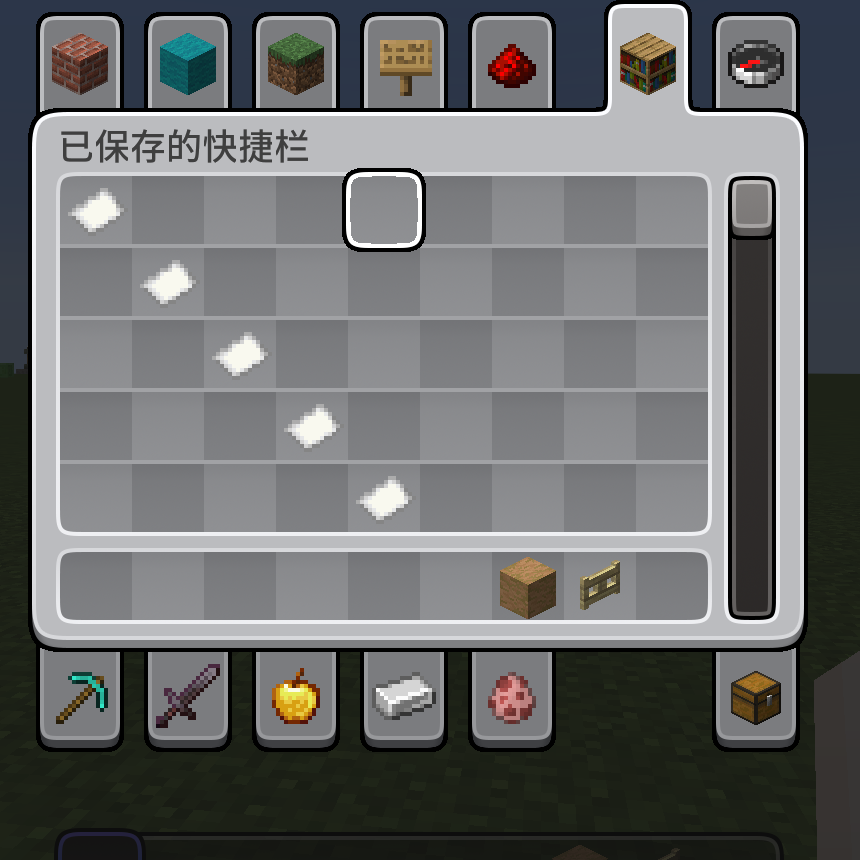
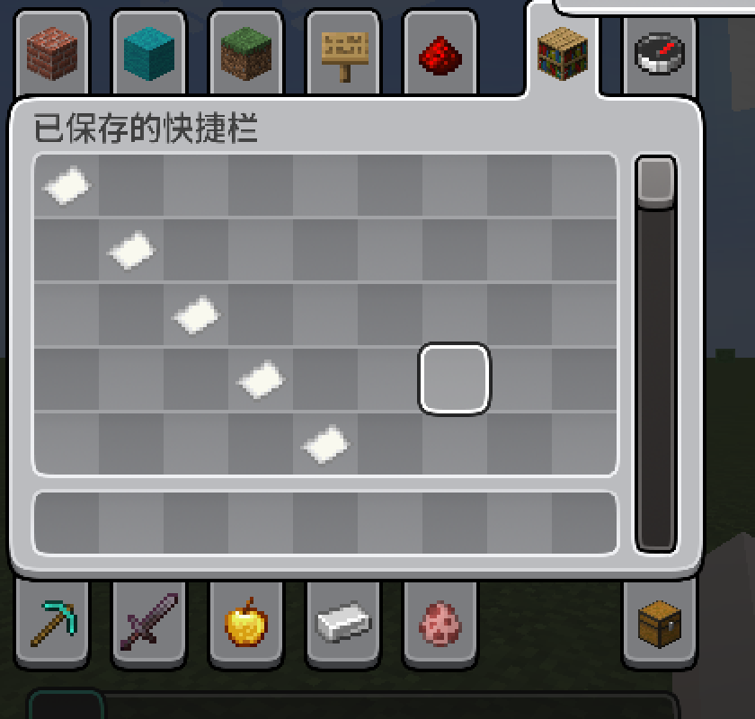
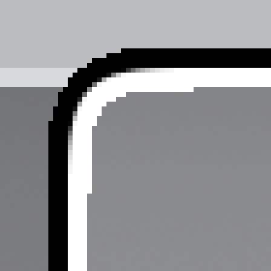
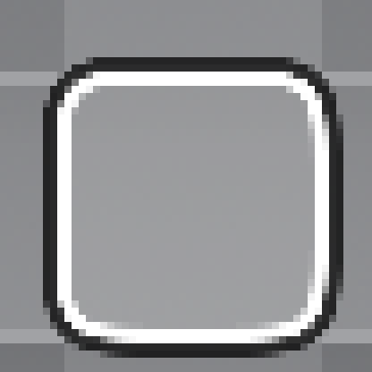

# TooltipFix

把 **Minecraft 1.21.2** 引入的「材质包可以重定义 GUI 外观」这套东西，以 **独立补丁模组**的形式回移到更早的版本。

不改任何上游模组或原版 jar，不要求材质包作者改包，也不依赖 Gradle。

| 目录 | Minecraft | 加载器 | 版本 | 产物 |
| --- | --- | --- | --- | --- |
| [`1.20.1`](1.20.1) | 1.20.1 | Forge 47.x / Fabric | 1.0.28 | `tooltipfix-1.20.1-forge-*.jar` + `tooltipfix-1.20.1-fabric-*.jar` |
| [`1.21.1-fabric`](1.21.1-fabric) | 1.21.1 | Fabric | 1.0.4 | `tooltipfix-1.21.1-fabric-*.jar` |
| [`1.21.1-neoforge`](1.21.1-neoforge) | 1.21.1 | NeoForge 21.1.x | 1.0.6 | `tooltipfix-1.0.6.jar` |

## 背景

1.21.2 把一批**硬编码绘制**的 GUI 元素换成了 **GUI sprite**：

```
assets/minecraft/textures/gui/sprites/tooltip/background.png     物品悬浮框底板
assets/minecraft/textures/gui/sprites/tooltip/frame.png          悬浮框边框（可动图）
assets/minecraft/textures/gui/sprites/container/slot_highlight_* 格子悬浮高亮框
assets/minecraft/textures/gui/sprites/widget/button*.png         按钮底板
...
```

并在 `.mcmeta` 里新增了 `"stretch_inner": true`（九宫格内区拉伸而非平铺）。
结论是材质包从此能重画这些控件——但只有 1.21.2+ 认。把 1.21.2 材质包放到 1.20.1 / 1.21.1 上，
这些贴图会被**静默忽略**（1.21.1）或者**根本不存在 sprite 概念**（1.20.1 完全没有 `GuiSpriteManager`）。

本模组就是补这一步。

## 各变体覆盖范围

| 能力 | 1.20.1 | 1.21.1 Fabric | 1.21.1 NeoForge |
| --- | :-: | :-: | :-: |
| 物品悬浮框 sprite（`tooltip/background` + `frame`） | ✅ | ✅ | ✅ |
| `nine_slice` 的 `stretch_inner` | ✅ | ✅ | ✅ |
| 格子悬浮高亮框（`container/slot_highlight_back` / `_front`） | ✅ | ✅ | ✅ |
| HUD（快捷栏 / 选中框 / 副手 / 经验条 / 跳跃条 / 攻击指示器） | ✅ | — | — |
| 按钮底板（`widget/button*`） | ✅ | — | — |
| 药水效果背景 | ✅ | — | — |
| 动画 sprite（`.mcmeta` 的 `animation.frames` / `frametime`） | ✅ | 原版管线 | 原版管线 |

### 效果

| 悬浮框 + 格子高亮（材质包 A） | 悬浮框 + 格子高亮（材质包 B） |
| --- | --- |
|  |  |
|  |  |

1.20.1 那条线是工作量的大头：它**根本没有 GUI sprite 管线**，所以
[`GuiSprite.java`](1.20.1/src/common/java/meow/tooltipfix/client/GuiSprite.java) 自己读材质包里的
`assets/minecraft/textures/gui/sprites/**.png` 与 `.mcmeta`，实现九宫格、`stretch_inner`、逻辑画布
（`gui.scaling.width/height`）、`animation` 帧序列。

## 安装

1. 把对应 jar 放进实例的 `mods\`；
2. 把面向 **1.21.2+** 的材质包放进 `resourcepacks\` 并启用（它提供 `gui/sprites/` 下的贴图）；
3. 重启游戏。

材质包没提供某张贴图时，该控件自动回落原版绘制，不会变成黑白格。
1.21.1 两个变体是纯客户端补丁模组，不需要 Fabric API / 其它前置。

## 构建

三个变体都**不用 Gradle**：`javac` 对着具名（mojmap）的 Minecraft 类编译 → `tools/Remap.java`
（自写的 ASM 重映射器）把整个 jar 改写成目标加载器的运行期命名空间 → 拼装资源与元数据。

```powershell
set JAVA_HOME=C:\Program Files\<jdk 21>
powershell -NoProfile -ExecutionPolicy Bypass -File 1.20.1\build.ps1
```

> 为什么不用 tiny-remapper / `jar-in-jar`：tiny-remapper 会把「两个命名空间里类名相同」的映射
> **整类跳过**，而 Forge 的 named→SRG 恰好是「类名不变、只改成员名」，于是它会静默地什么都不做。

### 本仓库**不含**的构建依赖

这些是 Mojang 的版权物或机器相关的路径，不随仓库分发：

| 缺什么 | 1.20.1 | 1.21.1 Fabric | 1.21.1 NeoForge | 怎么补 |
| --- | :-: | :-: | :-: | --- |
| 具名 Minecraft 类 | `1.20.1-named.jar`（放 `1.20.1\`） | `-NamedClasses <dir>` | `-NamedMcClasses <dir>` | ForgeGradle / NeoGradle 的 named 输出，或用 Vineflower 反编译 client jar |
| 映射表 `tools\maps\*.tiny` | ✔ | ✔ | — | 由 `tools/build-maps.js` + `tools/hierarchy.js` 从 Mojang 映射表生成 |
| ASM 9.7 jar 路径 `tools\asm-cp.txt` | ✔ | ✔ | — | 复制 `tools\asm-cp.txt.example` 填自己的路径 |
| `.minecraft\libraries` | ✔ | ✔ | ✔ | 任意装过对应加载器的实例（`-McRoot` 指定，默认 `%APPDATA%\.minecraft`） |

`tools/Remap.java` 会在第一次构建时自动编译，不需要预先生成 `tools\remap-build`。

## 已知取舍

- **不实现 `.mcmeta` 的 `interpolate`**（帧间插值），动图按 `frametime` 逐帧切换。
- 1.21.2 的 `tooltip_style` 物品组件（按物品指定 `tooltip/<style>_background`）没有移植——那属于数据组件，不是材质包能力。
- 装了模组后 tooltip 走 sprite 绘制，原版/NeoForge 事件里的颜色常量不再生效（1.21.2 本身也是如此）。
- 1.20.1 只回移「材质包真的能改」的那几块；滑条、输入框、复选框等控件仍走 1.20.1 老的 `widgets.png`。

## 致谢与许可

[MIT](LICENSE) © 2026 wuliaoppx。

Minecraft 是 Mojang Studios 的商标；本项目与 Mojang / 各加载器团队无隶属关系。
