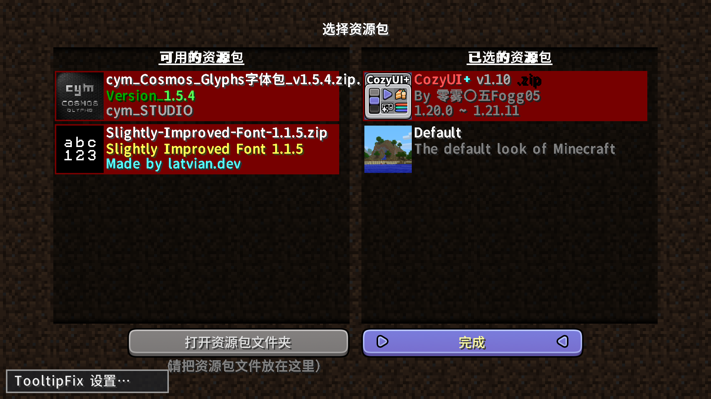
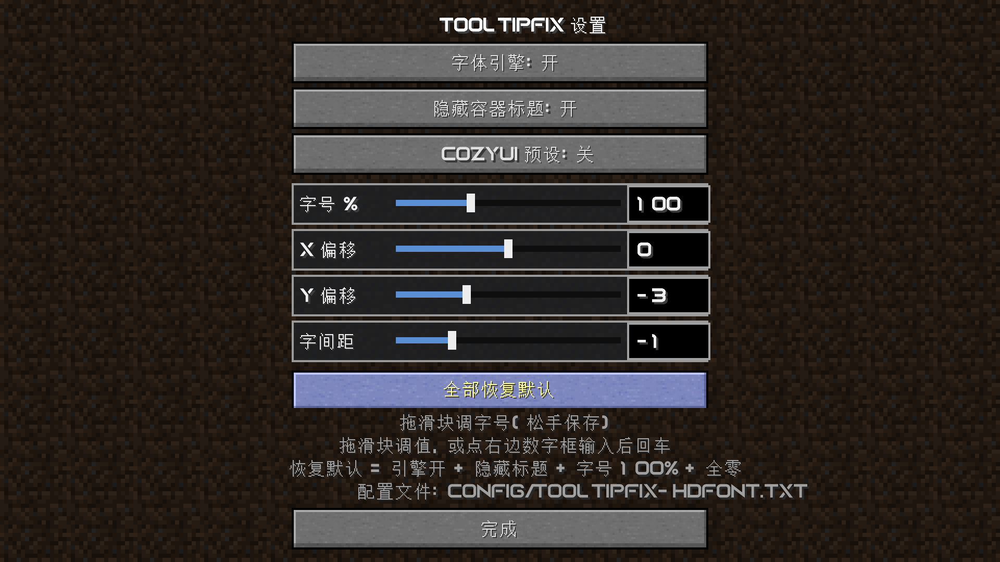
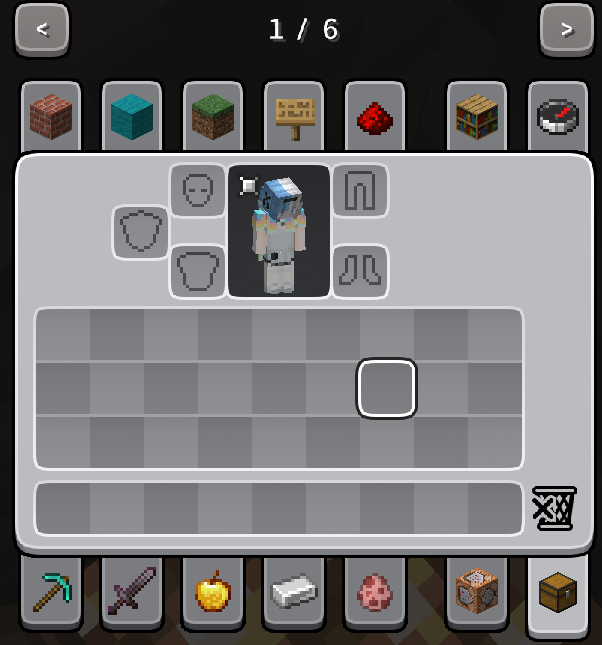
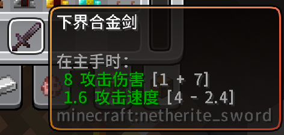
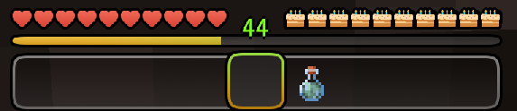
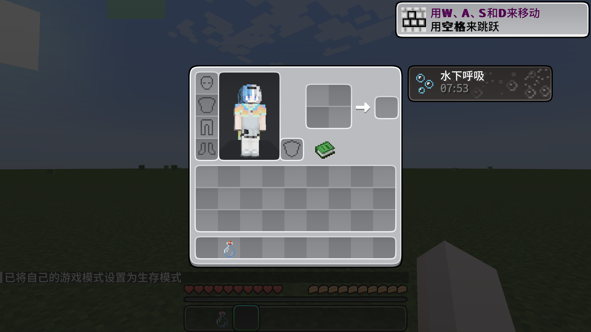

# TooltipFix

该模组完全由Ai创造！！！！

把 **Minecraft 1.21.2** 引入的「材质包可以重定义 GUI 外观」这套东西，以 **独立补丁模组**的形式回移到更早的版本。

不改任何上游模组或原版 jar，不要求材质包作者改包，也不依赖 Gradle。

| 目录 | Minecraft | 加载器 | 版本 | 产物 |
| --- | --- | --- | --- | --- |
| [`1.12.2`](1.12.2) | 1.12.2 | Forge 14.23.5.2864 | 1.0.0 | `tooltipfix-1.0.0.jar` |
| [`1.20.1`](1.20.1) | 1.20.1 | Forge 47.x / Fabric | 1.0.28 | `tooltipfix-1.20.1-forge-*.jar` + `tooltipfix-1.20.1-fabric-*.jar` |
| [`1.21.1-fabric`](1.21.1-fabric) | 1.21.1 | Fabric | 1.0.4 | `tooltipfix-1.21.1-fabric-*.jar` |
| [`1.21.1-neoforge`](1.21.1-neoforge) | 1.21.1 | NeoForge 21.1.x | 1.0.6 | `tooltipfix-1.0.6.jar` |

## 背景

1.21.2 把一批**硬编码绘制**的 GUI 元素换成了 **GUI sprite**：

```
assets/minecraft/textures/gui/sprites/tooltip/background.png     物品悬浮框底板
assets/minecraft/textures/gui/sprites/tooltip/frame.png          悬浮框边框（可动图）
assets/minecraft/textures/gui/sprites/container/slot_highlight_* 格子悬浮高亮框
assets/minecraft/textures/gui/sprites/widget/button*.png         按钮底板
...
```

并在 `.mcmeta` 里新增了 `"stretch_inner": true`（九宫格内区拉伸而非平铺）。
结论是材质包从此能重画这些控件——但只有 1.21.2+ 认。把 1.21.2 材质包放到 1.20.1 / 1.21.1 上，
这些贴图会被**静默忽略**（1.21.1）或者**根本不存在 sprite 概念**（1.20.1 完全没有 `GuiSpriteManager`）。

本模组就是补这一步。

## 各变体覆盖范围

| 能力 | 1.20.1 | 1.21.1 Fabric | 1.21.1 NeoForge |
| --- | :-: | :-: | :-: |
| 物品悬浮框 sprite（`tooltip/background` + `frame`） | ✅ 模组 | ✅ 模组 | ✅ 模组 |
| `nine_slice` 的 `stretch_inner` | ✅ 模组 | ✅ 模组 | ✅ 模组 |
| 格子悬浮高亮框（`container/slot_highlight_back` / `_front`） | ✅ 模组 | ✅ 模组 | ✅ 模组 |
| HUD（快捷栏 / 选中框 / 副手 / 经验条 / 跳跃条 / 攻击指示器） | ✅ 模组 | ✅ 原版 | ✅ 原版 |
| 按钮底板（`widget/button*`、滑条、输入框、复选框、标签页） | ✅ 模组 | ✅ 原版 | ✅ 原版 |
| 药水效果背景（`hud/effect_background(_ambient)`、`container/inventory/effect_background_large/_small`） | ✅ 模组 | ✅ 原版 | ✅ 原版 |
| 动画 sprite（`.mcmeta` 的 `animation.frames` / `frametime`） | ✅ 模组 | 原版管线 | 原版管线 |

1.21.1 原版本体就已经把这些控件改成 GUI sprite 绘制（`Gui` 里的 `hud/*`、`AbstractButton` 里的 `widget/button*`、`EffectRenderingInventoryScreen` / `Gui` 里的 `effect_background*`），所以**材质包在 1.21.1 上是开箱即用的，模组只补 tooltip、格子高亮、`stretch_inner` 这三块**；1.20.1 完全没有 GUI sprite 管线，才需要模组把上面每一行都补出来。药水效果背景在 1.20.1 上于 1.0.17 完成（HUD 24×24 与物品栏效果列表 120×32 / 32×32 两处）。

上表**不含 1.12.2**：那个版本连 `textures/gui/sprites/` 这套资源位置都不存在，能力边界没法用同一张表表达，
见下一节。

### 1.12.2 分支：实现方式和上面三条线**完全不同**

> **点名**：`1.12.2/` 不是其它变体的降级版，代码一行都不共用。上面三条线都建立在
> 「1.13+ 已经存在 GUI sprite 资源位置 + 已经存在 Mixin / Fabric 事件」这个前提上，
> 而 1.12.2 这两样**都没有**。所以这个变体是 **FML coremod**：注册 `IClassTransformer`，
> 在类加载期用 ASM 直接改写原版 `Gui` / `GuiScreen` / `GuiMainMenu` / `FontRenderer` 的**方法体**。
> 别的变体补的是「资源从哪读」，1.12.2 补的是「这个方法怎么写」——一个在数据层，一个在字节码层。

具体来说，1.12.2 比 1.20.1 还早：**连 `textures/gui/sprites/` 这套资源位置都不存在**，也没有 Mixin，
更没有 1.13+ 的字体提供器系统（`font/default.json` 里的 bitmap / ttf / unihex）。coremod 因此做两件事：

1. 把 1.21.2 材质包提供的 sprite 映射回 1.12.2 那些**硬编码**的绘制调用（`Gui.drawTexturedModalRect`
   等三个基础图元），靠 `(u, v, w, h) + 当前绑定贴图` 认出「这是哪块 GUI」；
2. 自己实现一套 HD 字体引擎，接管 1.13+ 字体包（bitmap provider、ttf provider，以及只给
   `textures/font/ascii.png` 的老式字体包），字体缺某个字形时**逐字符**落回原版 unicode 页。

它**不是**「把 CozyUI 的观感搬进 1.12.2」：模组自己不带美术资源，每一处替换的前提都是
「当前材质包确实提供了这个资源」，没有就原样回落原版行为。五个 transformer、反色混合律、
字体引擎、游戏内设置界面与全部开关见 [`1.12.2/README.md`](1.12.2/README.md)。

| 资源包界面的设置入口（左下角） | 游戏内设置界面（引擎 / 标题 / 预设 / 字号 / 偏移 / 间距） |
| --- | --- |
|  |  |

1.12.2 实测截图，演示材质包 **CozyUI+ v1.10** + **cym_Cosmos_Glyphs 字体包 v1.5.4**。
右图那套细体拉丁字母与数字来自字体包里的**矢量字体（ttf）**，中文仍由原版 unicode 页渲染——
两种字形能并排显示，就是字体引擎逐字符回落的结果。

### 效果

| 容器底板 / 格子 / 按钮 | 物品提示框 | 生命·饥饿·经验条·快捷栏 | 药水效果（HUD + 物品栏列表） |
| --- | --- | --- | --- |
|  |  |  |  |

全部为实测截图（1.20.1 + 面向 1.21.2 的材质包）。

1.20.1 那条线是工作量的大头：它**根本没有 GUI sprite 管线**，所以
[`GuiSprite.java`](1.20.1/src/common/java/meow/tooltipfix/client/GuiSprite.java) 自己读材质包里的
`assets/minecraft/textures/gui/sprites/**.png` 与 `.mcmeta`，实现九宫格、`stretch_inner`、逻辑画布
（`gui.scaling.width/height`）、`animation` 帧序列。

## 安装

1. 把对应 jar 放进实例的 `mods\`；
2. 把面向 **1.21.2+** 的材质包放进 `resourcepacks\` 并启用（它提供 `gui/sprites/` 下的贴图）；
3. 重启游戏。

材质包没提供某张贴图时，该控件自动回落原版绘制，不会变成黑白格。
1.21.1 两个变体是纯客户端补丁模组，不需要 Fabric API / 其它前置；1.12.2 也是纯客户端，
额外要求 Forge 14.23.5.2864，并在游戏内「资源包」界面左下角提供设置入口。

## 构建

三条线都**不用 Gradle**，各自带一个 `build.ps1`：

| 目录 | 编译对象 | 产物怎么来 |
| --- | --- | --- |
| `1.12.2` | srg 命名的 MC + Forge jar（`javac` 直接编） | 打出 jar，`FMLCorePlugin` 写在 manifest 里 |
| `1.20.1` | 具名（mojmap）的 MC 类 | `1.20.1/tools/Remap.java`（自写的 ASM 重映射器）把整个 jar 改写成目标加载器命名空间 → 拼装资源与元数据 |
| `1.21.1-*` | 具名 MC 类 | 同上，走 Fabric / NeoForge 各自的名字空间 |

```powershell
# 1.12.2：编译 + 打包（-Deploy 顺便丢进实例的 mods/）
powershell -NoProfile -ExecutionPolicy Bypass -File 1.12.2\build.ps1 -Deploy

# 1.20.1 / 1.21.1：需要 JDK 21
set JAVA_HOME=C:\Program Files\<jdk 21>
powershell -NoProfile -ExecutionPolicy Bypass -File 1.20.1\build.ps1
```

> 为什么不用 tiny-remapper / `jar-in-jar`：tiny-remapper 会把「两个命名空间里类名相同」的映射
> **整类跳过**，而 Forge 的 named→SRG 恰好是「类名不变、只改成员名」，于是它会静默地什么都不做。

### 本仓库**不含**的构建依赖

这些是 Mojang 的版权物或机器相关的路径，不随仓库分发：

| 缺什么 | 1.12.2 | 1.20.1 | 1.21.1 Fabric | 1.21.1 NeoForge | 怎么补 |
| --- | :-: | :-: | :-: | :-: | --- |
| MC 运行期命名的类 jar | `client-1.12.2-srg.jar`（`-SrgJar` 指定） | `1.20.1-named.jar`（放 `1.20.1\`） | `-NamedClasses <dir>` | `-NamedMcClasses <dir>` | ForgeGradle / NeoGradle 的输出，或用 Vineflower 反编译 client jar 后重映射 |
| 映射表 `tools\maps\*.tiny` | — | ✔ | ✔ | — | 由 `1.20.1/tools/build-maps.js` + `1.20.1/tools/hierarchy.js` 从 Mojang 映射表生成 |
| ASM 9.7 jar 路径 `tools\asm-cp.txt` | — | ✔ | ✔ | — | 复制 `1.20.1/tools/asm-cp.txt.example` 填自己的路径 |
| `.minecraft\libraries` | ✔ | ✔ | ✔ | ✔ | 任意装过对应加载器的实例（`-LibRoot` / `-McRoot` 指定，默认 `%APPDATA%\.minecraft`） |

`1.20.1/tools/Remap.java` 会在第一次构建时自动编译，不需要预先生成 `tools\remap-build`。
`1.12.2` 那条线的依赖清单直接从启动器的 profile json 读（1.12.2 是 LWJGL **2**，手写清单最容易翻车），
srg jar 找不到时 `build.ps1` 会依次试几个常见位置，都没有就报错并说明该放哪。

## 已知取舍

- **不实现 `.mcmeta` 的 `interpolate`**（帧间插值），动图按 `frametime` 逐帧切换。
- 1.21.2 的 `tooltip_style` 物品组件（按物品指定 `tooltip/<style>_background`）没有移植——那属于数据组件，不是材质包能力。
- 装了模组后 tooltip 走 sprite 绘制，原版/NeoForge 事件里的颜色常量不再生效（1.21.2 本身也是如此）。
- 1.20.1 只回移「材质包真的能改」的那几块；滑条、输入框、复选框等控件仍走 1.20.1 老的 `widgets.png`。

## 致谢与许可

[MIT](LICENSE) © 2026 wuliaoppx。

Minecraft 是 Mojang Studios 的商标；本项目与 Mojang / 各加载器团队无隶属关系。
